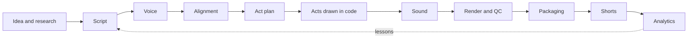

# The Wealth Gap: an automated studio for finance explainers

This repository turns a creator's plain-text idea into a finished 8 to 10 minute YouTube explainer. It also produces
the video's titles, thumbnails, vertical shorts and post-release analysis. Every frame of animation is drawn by code.
Every on-screen number comes from a source, and the human decisions are made at a small number of approval gates.
Everything else is a pipeline of command-line steps that read and write files, coordinated by a local web dashboard
that also works from a phone.

The project is not a template wrapped around a video API. It combines several systems that each had to be built and
tuned:

- a deterministic motion-graphics engine;
- a speech pipeline that measures its own takes;
- a word-level timing model that links narration, animation and sound;
- multi-model authoring and review;
- incremental rendering;
- a fact discipline that runs from the script to the thumbnail;
- a feedback loop from YouTube analytics back into the prompts.

| | |
|---|---|
| Pipeline code | about 42,000 lines of TypeScript, 4,500 lines of Python |
| Command-line steps | 82 `bun run` scripts |
| Dashboard actions | 77, each validated against an allowlist |
| Model roles | 21 (writer, director, act author, critic, thumbnail designer, analytics reviewer, …), each routable to a different provider |
| House styles | Briefing, Drafting, and a 9:16 Shorts variant |
| Automated checks | 31 test files run in CI on every push, plus a typecheck of the pipeline and the web app |

Figures as of November 2026.

## Contents

1. [How a video is made](#how-a-video-is-made)
2. [What makes it hard, and how it is solved](#what-makes-it-hard-and-how-it-is-solved)
3. [The human in the loop](#the-human-in-the-loop)
4. [The dashboard](#the-dashboard)
5. [Repository layout](#repository-layout)
6. [Getting started](#getting-started)
7. [Testing](#testing)
8. [Design principles](#design-principles)
9. [Further documentation](#further-documentation)

## How a video is made



| Stage | What happens | Output |
|---|---|---|
| Ideation | Ideas are scored against the audience brief. Five title-and-thumbnail concepts are drafted before any script, so the video is planned around a promise that can be packaged. | `idea.md`, concept sheet |
| Research | A researcher model finds a source for each claim. The program then opens every page and marks a fact verified only if the quoted sentence is really on it. | `research.md` |
| Script | The writer turns the draft into a chunked, hook-scored narration with delivery marks and on-screen hints. It declares every factual claim with its source, and a free fact check lists what still needs verifying. | `script_raw.md`, `claims.json`, `factcheck.md` |
| Voice | Gemini TTS by default, or a local Qwen3-TTS clone of the channel voice. Each block is read whole, and every take is transcribed and kept only if its word error rate is within tolerance. | section audio, `full_voiceover.wav` |
| Alignment | Word-level transcription, mastering, captions and the YouTube `.srt` file. | `captions.json`, `.srt` |
| Plan | A director model splits the narration into about ten acts of 40 to 90 seconds. Each act gets beats, tempo, an energy curve, recurring cast and sourced data. A validator checks the plan and prints variety notes. | `acts.json` |
| Acts | An act author writes each act as a TypeScript canvas program, renders it densely, and runs it through deterministic checks and a vision critic. | `src/scenes/A01_*.tsx` |
| Sound | Foley events declared by the acts, an automatic score keyed to act changes and silences, thinning of clutter, then a mix and master. | `events.json`, mix |
| Render | Per-act rendering with content-addressed reuse. Transitions between acts are planned and checked frame by frame. QC fails hard on placeholders, loudness and duration. | `draft.mp4`, `final.mp4` |
| Packaging | Three title-and-thumbnail packages built as three different bets. Thumbnails are rendered from the same drawing engine. A phone-size legibility check, a blind viewer and a critic review them. | `metadata.json`, thumbnails |
| Shorts | Two or three standalone vertical shorts per video. They go through the same pipeline at 1080×1920, with their own scripts, voice and animation. | `shorts/S1…` |
| Delivery | Every mix and stem, plus a Final Cut Pro project (FCPXML 1.11) with the voice, each sound effect and the music on separate roles. | `08-deliver/` |
| Analytics | YouTube numbers are pulled read-only and diagnosed against the channel's medians. A reviewer writes lessons, which are appended to prompts only after approval. | `workflow/learning/` |

## What makes it hard, and how it is solved

### Animation that is code, and deterministic

There is no stock footage and no timeline editor. Each act is a program that draws onto a canvas inside Remotion,
using the house style's kit (`packages/kit`). The kit provides paper-cut letterforms from font outlines, a camera
with focus moves, characters, charts, logos and transitions. Act code must be a pure function of time: no
randomness, no clocks, no state between frames. That makes any frame reproducible on its own, so acts render in
parallel and can be cached safely.

Visual hits come from the spoken words. `ctx.word("debt", 2)` returns the moment the second "debt" is said, and the
animation is complete by then. Sound effects are declared by the same act, from the same word times. Picture, voice and
sound therefore stay in sync even when the narration is re-recorded.

### Quality control that does not rely on taste alone

Every act is rendered every 0.1 s and run through deterministic checks:

- objects that pop in or out, blank or frozen screens, hard cuts;
- text that is clipped, overlapping or low in contrast;
- hits that land late, an ending that does not settle.

A vision critic then scores motion grids (12 frames per image, each with the words spoken at that moment) against
the style's rubric, and marks each finding real or false. A separate sync review gives a model the act's word-aligned
narration, so it can report problems like "this appears six seconds before it is said". Transitions between acts are
planned by a single owner using the neighbours' real frames, rendered as short clips and checked for flicker, jumps
and empty screens.

### Facts are a pipeline property, not a promise

On-screen numbers may only come from the plan's sourced `data`. Every factual claim in the script is declared with
its source. The program checks web research by fetching the page and finding the quoted sentence. Titles,
thumbnails and shorts are checked against the same sourced figures, and figures that come only from the narration
are flagged for a human fact check. Nothing is published with an unverified number unless a person has seen it and
accepted it.

### Change one line, redo one line

A revised script does not mean a new video:

- Only the changed parts are rewritten; untouched parts are restored character for character.
- Only new or changed lines are voiced again; matching takes are kept.
- The plan's acts and beats move to the new voice by matching words, with no model call.
- Only acts whose narration changed are redrawn.
- Rendering is per act and content-keyed. A key covers the act's file, its timeline entry, the template, the kit
  source, the render scale and the neighbour frames its transitions show. An unchanged act is never rendered twice,
  and the joined result is bit-exact and frame-count checked.

### Voice that sounds performed, not stitched

Each narration block is sent to the voice model as a whole, so phrasing and breaths come from the model rather than
from concatenated sentences. Takes are transcribed and accepted only below a word-error threshold. When the picture
needs more time than the narration gives, the voice pauses, but only at true pause points: sentence or phrase ends
where the waveform is genuinely silent. Each pause shifts the plan's timings with it.

### Audio to broadcast targets

Sound effects come from a curated library limited to commercially safe licences (CC0, public domain, CC BY, whose credits go into the description). Each event keeps its own seed, so removing one sound never changes the others. An
automatic score adds transitions on act changes, swells into chapters, and a riser into silence into a hit on
planned pauses. Clutter is thinned by rule: pile-ups, more than six foley sounds in five seconds, and big sounds too
close together. The master targets -14 LUFS with true peaks limited at 4× oversampling. Music is a separate stem, so
it can be replaced in post.

### Models as interchangeable workers

Every model call goes through one agent runner (`workflow/05-video/src/lib/agent.ts`). It drives Claude Code, Codex,
OpenCode, Ollama or the Antigravity CLI headlessly, and returns text, cost, tokens and time in one shape. Each of the
21 roles is assigned a model in settings, and each step is limited to the tools it needs. Every run records its cost
and duration in the video's `timings.json`. Long jobs such as overnight act authoring read the provider's own usage
window: they start work only when it fits, and otherwise sleep until the window resets.

### Packaging as an experiment

Each video gets three packages designed as different bets. They differ in the lever that makes a stranger click, in
the thumbnail's composition axes, and in the words on the image. Each package is tied to the script sentence that
pays it off. Thumbnails are drawn with the same engine as the video. They are then shrunk to feed size and read back
with on-device text recognition, and a blind viewer model must be able to name what it sees. An optional vidIQ
integration adds title scores and AI thumbnail alternatives styled on the rendered ones. It runs only on request,
after a credit check, and never blocks the normal flow.

### A loop that learns, under supervision

After release, channel analytics are fetched read-only and diagnosed against the channel's own medians. An analytics
reviewer proposes lessons. A lesson reaches the writing, directing or packaging prompts only after the creator
approves it.

## The human in the loop

Automation stops at a fixed set of gates, and only a person can pass them:

| Gate | Decision |
|---|---|
| G1a | Approve the script. The voice will not run on an unapproved script, and any later edit needs a new approval. |
| G1 | Approve the act plan. |
| G2 | Approve the first act before the rest are drawn. |
| G3 | Watch the draft. |
| G4 | Approve the three packages. Approval is a hash of the images and metadata, so any change makes it stale. |
| SG1, SG2 | Approve the short scripts and the short drafts. |

Every blocking check can be accepted with a recorded override and undone later, so a check can never trap the
production. Paid steps are labelled with their measured cost before they run. No paid fix round runs without the
creator asking for it.

## The dashboard

`bun run dashboard` starts a local control room: a Bun server and a React app (Vite, Tailwind, shadcn components)
laid out like an IDE.

- **Safe by construction.** The browser sends an action key and options. The server checks them against the
  allowlist and builds the command line itself; it never runs a shell command from the page.
- **State from disk.** Step status is derived from the files in the workspace, so it survives restarts and hand
  edits.
- **Autopilot.** Takes a video from idea to downloads. Each step is set to run and continue, run and wait for review,
  wait for the creator, or skip. It notifies on the Mac and the phone when it needs a person.
- **Remote access.** `bun run dashboard:public` exposes it behind a password through Tailscale Funnel, for review from
  a phone.
- **Review tools.** Script reader with built-in speech and a downloadable audio version, per-act previews with
  timestamped notes, a seam reviewer, a sound-effect review with per-event gain, thumbnail feed mock-ups, and analytics
  and comment pages.

## Repository layout

```
packages/kit/                @wealthgap/kit: the drawing engines
  src/spy/                   Briefing style (paper-cut letters, camera, characters, transitions)
  src/draft/                 Drafting style (three inks and the Penny character)
  src/paper/                 shared canvas helpers, icons and company logos
brand-assets/mascot/         character art
workflow/
  01-ideation/               idea check, packages-first concepts
  02-scripting/              writer, web research with verification, retention pass, fact check
  03-voiceover/              Gemini and Qwen3 TTS, takes, pauses, partial re-voicing
  04-transcription/          word-level alignment
  05-video/                  director, act author, frames, critic, review, seams, assemble, render, QC
  06-audio/                  foley library, automatic score, mix, mastering
  07-publish/                titles, thumbnails, phone-size check, review, export, vidIQ
  08-shorts/                 vertical shorts: writer, stage runner, export
  09-analytics/              YouTube fetch, diagnosis, analytics reviewer, comments
  deliver/                   downloads and the Final Cut Pro project
  dashboard/                 server (router, jobs, allowlist, status, autopilot) and web app
  learning/                  approved lessons appended to prompts
  lib/                       model routing, usage window, vidIQ client, overrides
  prompts/                   the words each model role receives
  styles/                    STYLE.md, ACT.md and rubric per house style
scripts/                     workspace creation, renaming, compaction
workspace/<VIDEO>/           one video's files (gitignored)
```

Each step talks to the others only through files in `workspace/<VIDEO>/`. Any step can be re-run on its own, and
inspected or edited by hand.

## Getting started

Requirements: macOS on Apple silicon (the phone-size check uses on-device text recognition, and delivery targets
Final Cut Pro), [Bun](https://bun.sh), Python 3.11 managed with `uv`, `ffmpeg`, and the Claude Code CLI. Optional
extras: the Antigravity CLI (`agy`) for free review passes, a Gemini AI Studio key for the default voice, and a vidIQ
account.

```bash
bun install
uv venv --python 3.11 .venv
uv pip install --python .venv/bin/python \
  -r workflow/03-voiceover/requirements.txt -r workflow/06-audio/requirements.txt

bun run dashboard                          # the control room on http://127.0.0.1:4600
```

From the command line, a video goes roughly like this. The full runbook, with costs, timings and every flag, is
`VIDEO_PRODUCTION.md`.

```bash
bun run new-video VID20_Example            # creates workspace/VID20_Example/
# write 02-scripting/idea.md in plain text; [brackets] are instructions to the writer
bun run write --video VID20_Example        # script (paid), then review and:
bun run write --video VID20_Example --approve
bun run tts:format --video VID20_Example && bun run tts --video VID20_Example --combine
bun run transcribe --video VID20_Example   # then audio:master, captions, srt
bun run direct --video VID20_Example       # act plan (paid), approve it
bun run act --video VID20_Example --act A01
bun run frames --video VID20_Example --scene A01
bun run cues --video VID20_Example && bun run audio:mix --video VID20_Example
bun run draft --video VID20_Example        # then render and qc
bun run meta --video VID20_Example && bun run thumbs --video VID20_Example
```

## Testing

```bash
bun run test        # every repo test file, no rendering, no paid calls, about 4 seconds
bun run typecheck   # the pipeline and the web app
```

Both run in CI on every push, with no secrets. Tests point the server at temporary folders, so they never touch real
workspaces, keys or installed CLIs. The tests cover the places where a bug would cost the most:

- script, voice and act parity;
- word alignment and replanning;
- plan validation;
- the mix timeline;
- the FCPXML export;
- the dashboard's allowlist, option validation, locks and path handling.

## Design principles

1. **Files are the interface.** Steps share no memory; the workspace is the state. Anything can be re-run, diffed or
   fixed by hand.
2. **Determinism wherever possible.** The same inputs give the same frames, sounds and checks. Models write code and
   text; programs measure the results.
3. **Never invent data.** Numbers come from sources, and unverified figures are surfaced to a person rather than
   hidden.
4. **Spend deliberately.** Paid steps are explicit, priced and recorded. Cheap deterministic checks run before
   expensive model reviews, and small fixes are made by hand.
5. **Optional services never block.** External tools such as vidIQ add value when available and fall back cleanly when
   they are not.
6. **The creator decides.** Models propose; approvals, overrides and lessons belong to the person running the channel.

## Further documentation

| Document | Purpose |
|---|---|
| [`VIDEO_PRODUCTION.md`](VIDEO_PRODUCTION.md) | The runbook: every step, its cost and time, gates and fixes |
| [`docs/ARCHITECTURE.md`](docs/ARCHITECTURE.md) | Code map, module dependencies, the dashboard server, the shared-packages plan |
| [`CLAUDE.md`](CLAUDE.md) | Rules for act code and the repository conventions agents follow |
| [`packages/kit/src/spy/README.md`](packages/kit/src/spy/README.md) | Briefing engine API |
| [`packages/kit/src/draft/README.md`](packages/kit/src/draft/README.md) | Drafting engine API |
| [`workflow/07-publish/GUIDE.md`](workflow/07-publish/GUIDE.md) | Packaging rules: titles, thumbnails, the three bets |
| [`workflow/styles/`](workflow/styles/) | The house styles: look, sound, camera and act contract |
