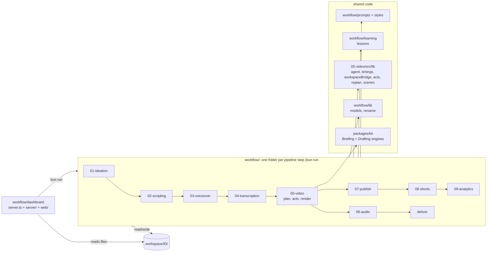

# Architecture

How the repo is put together: the parts, which modules each pipeline step uses, where code is duplicated, and how
the parts would split into shared packages if a second channel is started. How to *make* a video is in
`VIDEO_PRODUCTION.md`; this file is about the code.

## The picture

Every step is a CLI (`bun run <script> --video <ID>`) that reads and writes files in `workspace/<ID>/`. Nothing is
kept in memory between steps, so any step can be re-run alone, and the dashboard only needs to know which files each
step writes.

## The parts

**Pipeline steps (`workflow/01-ideation` … `09-analytics`, `deliver/`).** One folder per step, each with its own
CLI entry points (listed in `package.json`). They talk to each other only through files in the workspace
(`02-scripting/script_raw.md` → `03-voiceover/sections/` → `04-transcription/` → `05-video/captions.json` →
`acts.json` → scene files → `timeline.json` → renders). Python is used where the audio and ML tooling is
(TTS, faster-whisper, mixing), always behind a TypeScript wrapper (`06-audio/py.ts`). Which modules each step uses
besides its own folder (measured from the imports):

| Step | Uses |
|---|---|
| 01-ideation | 05-video/src/lib (agent), lib (models), 07-publish, 09-analytics |
| 02-scripting | 05-video/src/lib (agent, timings), lib, learning |
| 03-voiceover | 05-video/src/lib (timings) |
| 04-transcription | 03-voiceover (section types) |
| 05-video | its own src/lib, packages/kit, lib, learning, 02-scripting (script reader) |
| 06-audio | 05-video/src/lib (workspaceBridge) |
| 07-publish | 05-video/src/lib (agent, timings, acts), lib, learning |
| 08-shorts | 05-video/src/lib, 07-publish, 02-scripting, lib, learning |
| 09-analytics | 05-video/src/lib (agent), lib, learning |
| deliver | 06-audio (mix.py, python finder) |
| dashboard | every step's files (read), 07-publish, 08-shorts and 09-analytics libs, lib |

**Agent runs (`05-video/src/lib/agent.ts`) and model routing (`workflow/lib/models.ts`).** Every model call in the
pipeline goes through `agent.ts`: one function that runs Claude Code, Codex, OpenCode, Ollama or agy headless and
returns text, cost, tokens and time in one shape. `models.ts` says which model runs each role (writer, director, act
author, critic…); defaults in `workflow/models.json`, edited in Settings → Agent models.

**Prompts and styles (`workflow/prompts/`, `workflow/styles/`).** The words the models get. `loadPrompt` appends
approved lessons from `workflow/learning/` (Analytics → Lessons). Styles pair a STYLE.md / ACT.md with a kit module.

**The kit (`packages/kit`).** The drawing engines the act code imports: `spy/` (Briefing), `draft/` (Drafting),
shared canvas helpers in `paper/`, logos and icons. Deterministic: everything is a function of `ctx.t`.

**The dashboard (`workflow/dashboard`).** A Bun server and a React app (`web/`, Vite + Tailwind). The server never
runs a shell: the page sends an action key and options, the server checks them against the allowlist and runs
`bun run <script>` with argv it built itself. Status is derived from the files on disk plus `dashboard.log`, so it
survives restarts and hand edits. The server is split by feature:

| Module | What it holds |
|---|---|
| `server.ts` | the router and the boot (ports, `--public`, shutdown) |
| `server/core.ts` | paths, flags, small fs/http helpers, the Host / `x-wg` guard |
| `server/jobs.ts` | running a job (spawn, logs, SSE, locks, resource sampling, run records) |
| `server/notify.ts`, `studio.ts`, `naming.ts` | job-end notifications, Remotion studio, naming untitled projects |
| `server/actions/` | the allowlist: `base.ts` (types, shared options, `args` validation, `commandFor`, locks), one file per step |
| `workflow/05-video/src/lib/chunks.ts` | per-act renders: each act's slice of Main rendered once and reused until its inputs change; draft, final and act previews join them |
| `server/autopilot.ts` | runs a video's steps by itself (idea → downloads), each in the mode you pick (auto / review / me / off); `workflow/lib/usage.ts` reads the Claude window |
| `server/status.ts` | step status from disk (stale / done / partial), approvals, act staleness |
| `server/details.ts` | everything one project's page shows, and the project list |
| `server/files.ts`, `settings.ts` | file serving (path checks, ranges), downloads, the web app; settings files, .env view |
| `server/routes/` | `app`, `settings`, `project`, `script`, `publish`, `shorts`, `acts`, `voice` |
| `analytics.ts`, `ideas.ts`, `listen.ts`, `public.ts`, `usage.ts`, `system.ts` | features that were already separate |

The web app lays pages out by the width of the content column (CSS container queries on `main`), not the window,
because the side panels take up to 600 px. Colours come from five seeds in `web/src/theme/channel.ts`.

## Where code is duplicated or sits in the wrong place

- **Generic infrastructure lives inside a step.** `agent.ts`, `timings.ts` and `workspaceBridge.ts` are in
  `05-video/src/lib` but are imported by every other step (agent 15×, timings 20×, workspaceBridge 17×). They are not
  about video. This is the main thing to move before sharing code.
- **Small helpers are re-declared per file.** `REPO` (13 definitions), `readJson` (7), `exists` / `mtime` / `sha` (3
  each). Harmless, but each copy has slightly different error handling.
- **`--video` parsing** is written by hand in 17 scripts; `06-audio/py.ts` has a `videoArg` that could serve all of them.
- **Spoken-word counting** exists three times (dashboard, `08-shorts/lib.ts`, `02-scripting/script_lib.ts`). They
  agree today on the writer's format; `server/test/script_parity.test.ts` keeps it that way.
- **Two rules are deliberately written twice and pinned by tests:** which scene file belongs to an act and whether
  its plan changed (dashboard `status.ts` vs `05-video/src/lib/scenes.ts`, see `status.test.ts`).

## Tests and CI

`bun run test` runs the repo's own test files (git-listed `*.test.ts` outside `tools/`) in under a second; `bun run typecheck` checks the pipeline and the web app. CI (`.github/workflows/ci.yml`)
runs both on every push: no secrets, no paid steps, no rendering. The tests where a bug would hurt most:

| Area | Tests |
|---|---|
| Script → voice → act parity | `server/test/script_parity.test.ts`, `server/test/status.test.ts` (scene ↔ plan parity) |
| Timing and alignment | `04-transcription/src/align.test.ts`, `05-video/src/lib/replan.test.ts`, `03-voiceover/src/holdlib.test.ts`, `05-video/test/timeline.test.ts` |
| Plan validation | `05-video/src/lib/acts.test.ts`, `plan_validation.test.ts` |
| FCPXML export | `deliver/fcpxml.test.ts` |
| Audio mix timeline | `05-video/src/lib/cues.test.ts` (foley edits → what the mix renders) |
| Dashboard safety | `server/test/actions.test.ts` (allowlist, option validation, locks), `files.test.ts` (path escapes, ranges) |

The server reads `WG_WS_ROOT`, `WG_ENV_FILE` and `WG_MODELS_CACHE` when set, so its tests use a temp folder and never
touch the real workspaces, `.env` or installed CLIs.

## Generic vs channel-specific

| Part | Generic | Channel-specific | Notes |
|---|---|---|---|
| Voice (`03-voiceover`: TTS engines, takes, WER check, pauses) | ✓ | voices/, tone notes | the channel voice is data |
| Transcription and alignment (`04-transcription`) | ✓ | | |
| Model routing and agent runs (`lib/models.ts`, `agent.ts`) | ✓ | role names | |
| Timings / cost records (`timings.ts`) | ✓ | | |
| Audio mastering, mix, music library (`06-audio`) | ✓ | music choices | |
| Delivery and FCPXML (`deliver/`) | ✓ | | |
| Dashboard shell (jobs, allowlist runner, status-from-disk, files, settings, theme, usage, machine) | ✓ | | |
| Dashboard pages per step, action list | mostly | step names, help texts | the list is data |
| Plan schema and checks (`acts.ts`), replan, scenes | ✓ (for act-based videos) | act length / BPM limits | |
| Kit engines (`spy/`, `draft/`), characters, icons | engines | Briefing / Drafting looks, Penny | a style per channel |
| Prompts (`WRITER`, `DIRECTOR`, `ACT`, `THUMBS`, …), voice.md, styles | | ✓ | finance voice, facts rules, house styles |
| Ideation, packaging rules, analytics lessons | engine | ✓ guides and lessons | |

## Proposal: shared packages (not done yet)

The aim is a second channel that reuses the engine and keeps its own voice, styles and prompts. In order, each step
small enough to land alone:

1. **`packages/core`.** Move `agent.ts`, `timings.ts`, `workspaceBridge.ts`, `models.ts`, `rename.ts` and one copy
   of the small helpers (`REPO`, `readJson`, `exists`, `mtime`, `sha`, `videoArg`) here. Steps import
   `@wealthgap/core`; `05-video/src/lib` keeps only video code. Mechanical; the typecheck finds every import.
2. **A channel config (`channel.json` at the repo root).** Name, palette seeds (today in
   `dashboard/web/src/theme/channel.ts`), logo path, default style, prompt folder, voice, act/short limits. Every
   place that hard-codes the channel reads it. The prompts and styles move under `channels/<name>/` and
   `loadPrompt` resolves through the config.
3. **`packages/voice`, `packages/align`, `packages/deliver`.** The voice engines + pause tools, transcription +
   alignment, and the mix / FCPXML delivery, each with its Python next to it and its tests. They take paths and
   options, never a channel name.
4. **`packages/dashboard`.** The server shell (`server/core`, `jobs`, `files`, `settings`, the action runner, the
   React shell and theme) with the action list, step pages and status rules passed in by the channel. The
   per-step `server/actions/*.ts` files already have the shape that list would take.
5. **Repos.** Keep one monorepo with `channels/wealthgap/` and later `channels/<next>/` until the packages are
   stable; only then publish them (a private registry or git dependencies) if the second channel needs its own repo.

What stays per channel: prompts, styles and the kit look, voice profiles, music choices, packaging guides, lessons,
the palette and logo. Risk to watch: the parity rules (scene ↔ plan, word counts) must move with their tests, never
apart.
