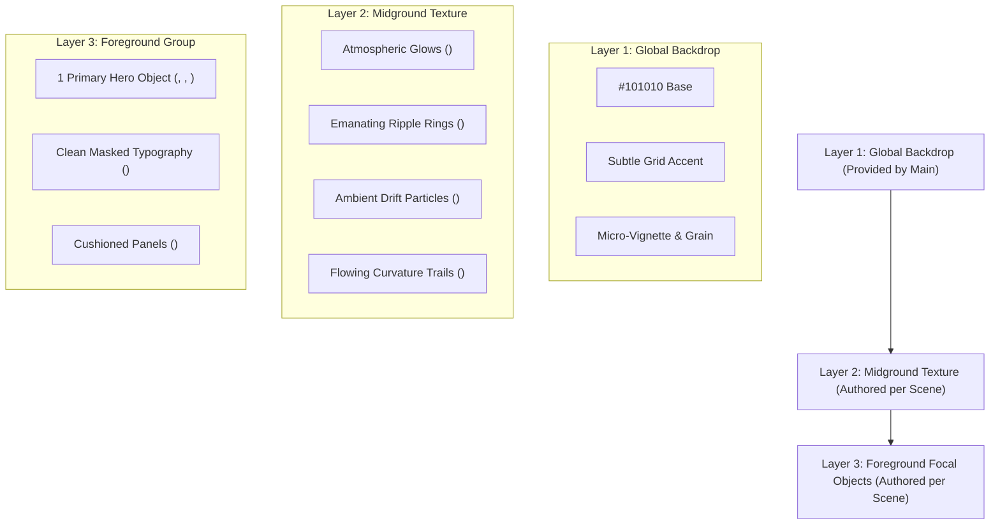

# 🎨 Visual Guidelines & Art Direction Standard

> **Target Standard:** Crafted, editorial motion graphics inspired by Vox, Polymatter, and custom code-rendered explainers.  
> **Normative Reference:** See [SCENE_AUTHOR.md](file:///Users/prakharsingh/youtube/WealthGap/workflow/prompts/SCENE_AUTHOR.md#L71-L115) §4 for full design rules and review checklist.

---

## 1. Core Visual Philosophy
- **Aesthetic:** "Swiss Minimalist Macro-Finance" on Deep Obsidian.
- **Tone:** Authoritative, investigative, tactile, engineered, and mathematically precise.
- **Principle:** Every visual element must clarify information or illustrate financial magnitude. Purely decorative clutter is banned.

---

## 2. Color System: Dark Mode Editorial & Pastels

- **Absolute Base:** `#101010` (`tokens.color.bg`). Never pure `#000000` or washed-out grays.
- **Surface Elevation:** `#181818` (`surface`), `#202020` (`surface2`). Never drop shadows; separate layers via soft surface elevation, subtle contour rings, and luminous rim glow.
- **Text & Linework:**
  - Primary: `#F4F4F8` (`tokens.color.text`, 87% crisp).
  - Secondary/Muted: `#8A8A94` (`tokens.color.muted`).
  - Grid: `rgba(255, 255, 255, 0.07)` (`tokens.color.grid`).
- **Pastel Token Palette (Objects & Entities):**
  - **Lavender:** `#C7B8FF` (`tokens.color.pastel.lav`) — Interbank, institutions, sovereign credit.
  - **Mint:** `#A8E6CF` (`tokens.color.pastel.mint`) — Liquidity, flows, positive growth.
  - **Peach:** `#FFC9A8` (`tokens.color.pastel.peach`) — Demographics, household wealth, consumers.
  - **Sky Blue:** `#A8D8FF` (`tokens.color.pastel.sky`) — Currencies, global trade, FX volume.
  - **Butter Gold:** `#FFE8A3` (`tokens.color.pastel.butter`) — Reserves, commodities, physical gold.
  - **Rose:** `#FFB3C7` (`tokens.color.pastel.rose`) — Debt pressure, inflation, systemic strain.
- **Data Accents:**
  - Gold Accent: `#F5B83D` (`tokens.color.accent`)
  - Teal Accent: `#2EC4B6` (`tokens.color.accent2`)
  - Green / Positive: `#3DDC97`
  - Red / Negative: `#FF5A5F`
- **Rule:** One dominant pastel hue per scene. Never use saturated neon primaries that vibrate against dark backgrounds.

---

## 3. Three-Layer Scene Architecture

Every scene is built strictly in three visual depth layers:

1. **Layer 1: Global Backdrop:**
   - Provided automatically by Remotion `Main.tsx` via `Backdrop.tsx`.
   - Scenes **must never** paint an opaque full-screen background or cover this layer.
2. **Layer 2: Midground Texture:**
   - Authored inside the scene: contour rings, soft radial ambient glows (`<Glow/>`), drift trails (`<Trail/>`), and floating micro-particles (`<Particles/>`).
   - Gives depth, scale, and organic life without competing with foreground text.
3. **Layer 3: Foreground Hero Group:**
   - **One single focal point** at any moment in time.
   - Everything secondary is smaller, dimmer, or muted.
   - Hero numbers use `<Counter/>` with gold or pastel rim; labels use `<Label/>`.

---

## 4. Entrance Vocabulary & Motion Physics

### 4.1 Permitted Entrance Vocabulary
Combine and layer these techniques:
- **Masked reveals:** Text or geometric silhouettes rise or wipe smoothly through a clip mask (`<Label/>`).
- **Morphing shapes:** Continuous geometric transformations (`shapes.lerp`, e.g. circle → squircle → hexagon → blob).
- **Spawn from a point:** Objects emerge from a parent node/rim, accelerate with `ease.outExpo`, and settle with a gentle spring overshoot while a `<Ring/>` ripple marks the birth.
- **Draw-on:** SVG paths, line charts, and contours draw progressively along their path (`strokeDasharray` / `strokeDashoffset`).
- **Camera storytelling:** Coordinated camera keyframes (`<Camera zoom={...} panX={...} />`) creating cinematic push-ins, pull-backs to reveal scale, or drift.
- **Pulses and breaths:** Hero objects inhale, swell, or glow on spoken emphasis anchors (`pulse()`).
- **Secondary motion & settle:** Trailing contour rings, soft squash-and-stretch, subtle overshoots.

### 4.2 Banned Generic Motion (Hard Rule)
- ❌ **No opacity-only fade-ins** or fade-outs.
- ❌ **No default slide-ins** across the entire screen.
- ❌ **No pop-ins** at frame 0 with linear or missing easing.
- ❌ **No static bullet points**, text walls, or centered paragraphs.
- ❌ **No random jitter/wobble** that is not linked to narrative meaning or physics.

### 4.3 Motion Quality & Timings
- **Lead the voice:** Visual arrivals must lead the spoken word by **150–250 ms** (`s.word(w).start + s.ms(-150)`).
- **House curve:** Exponential ease-out (`ease.bezier(0.16, 1, 0.3, 1)` or `ease.outExpo`).
  - Entrances: 0.5–0.8s for major heroes, 0.3–0.5s for secondary items.
  - Exits: Exactly half the entrance duration.
  - Stagger: 80–90ms between items; capped at 600ms total stagger.
- **Ambient Life Rule:** **Nothing stays completely motionless for more than 3.0 seconds.** Every scene must feature subtle camera drift, rotating rim lighting, gentle breathing, or drifting particles.
- **Visual Rhythm:** Something visibly updates, transforms, or highlights every 3–5 seconds.

---

## 5. Composition, Typography & Safe Areas

- **Safe Margins:** All critical visual elements and labels must stay strictly inside `tokens.safe` (96px horizontal, 54px vertical at 1080p).
- **Text Brevity:** Maximum **8 words on screen** at any given moment (excluding chart axes/sources).
- **Type Scale:**
  - Hero Numbers: `132px` (scaled relative to 1920).
  - Title / Section: `64px`–`84px`.
  - Body / Card Labels: `42px`–`52px`.
  - Minimum legibility: Never below `30px`.
- **Hold Times:** Any `<Label/>` must hold on screen for at least:
  $$\text{Hold Time} \ge 0.5\,\text{s} + 0.28\,\text{s} \times (\text{word count})$$
  Never exit a label while the narrator is actively speaking the words.
- **Mobile Legibility:** Stills must remain instantly readable and uncluttered when scaled down to mobile phone size (~400px width).

---

## 6. Financial Integrity & Data Rigor

1. **No Invented Numbers:** Every single statistic, metric, percentage, or dollar figure displayed on screen must be sourced directly from `storyboard.json`'s `data` block or the audio transcript.
2. **Metadata Tracking:** Every numerical value rendered must be recorded in `export const meta = { numbers: [...] }` with its source citation.
3. **Scale Metaphors:** Illustrative size metaphors (e.g. comparing market caps or liquidity pools) must never display arbitrary coordinate numbers that misrepresent actual scale.
4. **Editorial Neutrality:** No investment advice, no price predictions, and no unauthorized real-world corporate or media outlet logos.
